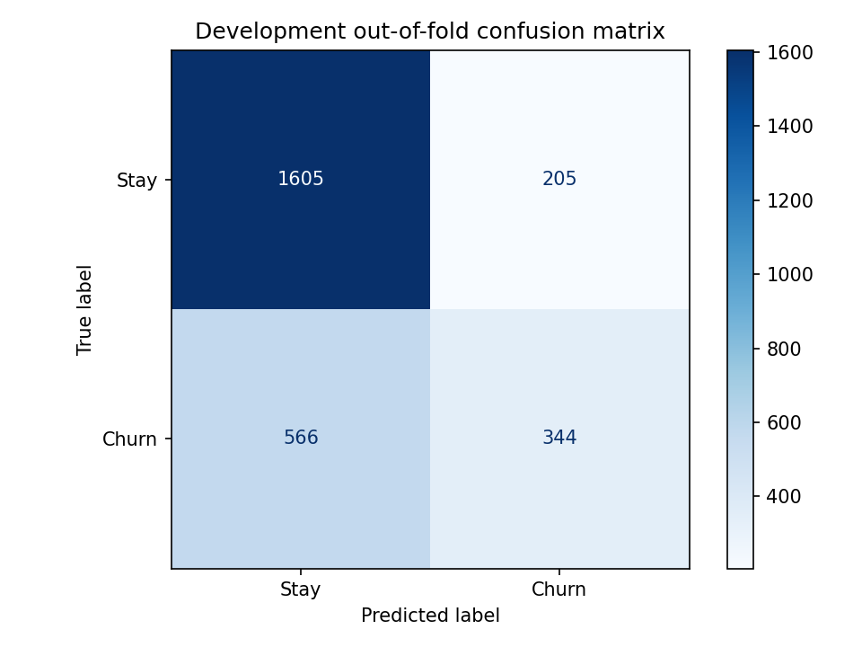
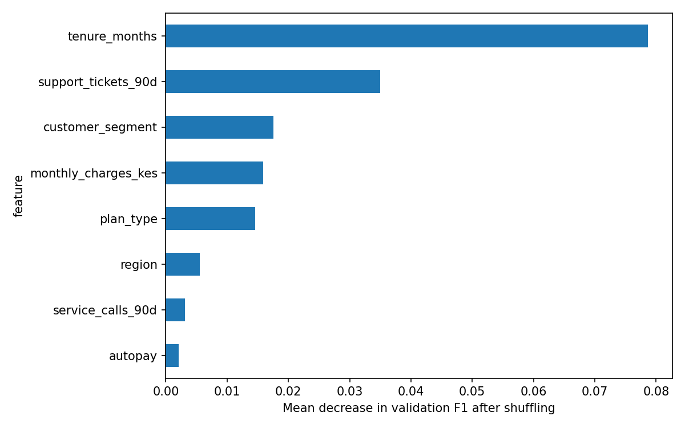

# DSA 2050A — Week 9: Model Selection and Evaluation

## Group Members

| Student ID | Name | Assigned Responsibility |
|---|---|---|
| 673804 | Victor Apamo | Data inspection, preprocessing and leakage prevention |
| 673308 | Whitney Jebor | Model training, cross-validation and hyperparameter tuning |
| 674139 | Sylvain Biket | Model evaluation, interpretation, documentation and GitHub coordination |

## 1. Project Objective

This project predicts customer churn for a fictional Kenyan internet provider using Python and machine learning.

We compared Logistic Regression and Decision Tree against a Dummy Classifier baseline to select a reliable model.

The dataset is synthetic and intended for educational purposes.

## 2. Dataset and Preprocessing

- Development dataset: 2,720 customers
- Final test dataset: 680 customers
- Churners in development data: 910 (33.46%)
- Target: `churn` (1 = cancelled, 0 = stayed)

Excluded `customer_id` and `cancellation_confirmed` to prevent data leakage.

Preprocessing included:
- Median imputation for numerical missing values.
- Most-frequent imputation for categorical missing values.
- StandardScaler for numerical variables.
- OneHotEncoder for categorical variables.
- Pipeline-based preprocessing to prevent leakage.

## 3. Model Comparison

All models used stratified 5-fold cross-validation with random_state=42. F1 was the primary evaluation metric.

| Model | Best Parameter | Mean F1 | F1 SD | Precision | Recall |
|---|---|---|---|---|---|
| Dummy Classifier | Most frequent | 0.0000 | 0.0000 | 0.0000 | 0.0000 |
| Logistic Regression | C=1 | 0.4701 | 0.0527 | 0.6243 | 0.3780 |
| Decision Tree | max_depth=3 | 0.3985 | 0.0487 | 0.5656 | 0.3176 |

Selected model: **Logistic Regression (C=1)**.

It achieved the highest mean F1 score, with comparable variation across folds and better interpretability.

The selection was frozen before final testing.

## 4. Confusion Matrix and Error Analysis

Out-of-fold development results:

| | Predicted Stayed | Predicted Churned |
|---|---|---|
| Actually Stayed | 1,605 | 205 |
| Actually Churned | 566 | 344 |

- False positives: 205
- False negatives: 566
- Development accuracy: 71.65%

False negatives are particularly important because these customers actually churned but were predicted to stay.



## 5. Subgroup Analysis

| Segment | Customers | Actual Churners | Recall | Precision | False Negatives |
|---|---|---|---|---|---|
| New | 452 | 261 | 0.7816 | 0.6518 | 57 |
| Established | 2,268 | 649 | 0.2157 | 0.5932 | 509 |

The model identified 78.16% of New churners but only 21.57% of Established churners.

Most missed churners belonged to the Established segment, indicating a significant performance limitation.

## 6. Permutation Importance

The two features with the highest predictive reliance were:

1. `tenure_months`: 0.0787 mean F1 decrease.
2. `support_tickets_90d`: 0.0350 mean F1 decrease.

Permutation importance measures predictive reliance, not causation. Correlated features can share importance.



## 7. Model Selection Rationale

Logistic Regression (C=1) was selected because its mean cross-validation F1 of 0.4701 exceeded Decision Tree's 0.3985, with comparable standard deviations (0.0527 and 0.0487).

The model produced 566 false negatives, highlighting difficulty identifying every churner. Subgroup recall was 78.16% for New customers but only 21.57% for Established customers.

Despite these limitations, Logistic Regression provided better overall F1 performance, relatively stable cross-validation results and a simpler, interpretable model.

The selection was finalized using development data only, before evaluating the untouched final test set.

## 8. Final Test Results

| Metric | Result |
|---|---|
| Accuracy | 70.00% |
| F1 Score | 0.4486 |
| Precision | 0.5845 |
| Recall | 0.3640 |
| True Negatives | 393 |
| False Positives | 59 |
| False Negatives | 145 |
| True Positives | 83 |

The final-test F1 was slightly lower than the cross-validation mean (0.4486 versus 0.4701).

The model missed 145 of 228 actual churners, indicating that improvements would be needed before real-world deployment.

No hyperparameters were changed after final testing.

## 9. Reflection Questions

**1. Why should models share the same folds?**

To ensure a fair comparison using identical training and validation partitions.

**2. What does F1 measure?**

F1 is the harmonic mean of precision and recall. It balances identifying churners and avoiding false alarms.

**3. Where do errors concentrate?**

False negatives, especially among Established customers, who accounted for 509 missed churners in development predictions.

**4. Which feature has the highest predictive reliance?**

`tenure_months`, with a mean F1 reduction of 0.0787.

**5. Why should the final test not be used for tuning?**

Because doing so leaks information from the independent test set into model selection and creates biased performance estimates.

## 10. Limitations and Conclusion

Limitations:
- The dataset is synthetic.
- Established customers have low recall.
- Many actual churners are missed.
- Customer behaviour may change over time.
- Feature importance does not prove causation.

Logistic Regression was the strongest model based on cross-validation F1. However, its low recall and subgroup differences demonstrate why model evaluation must consider more than accuracy.

## 11. Reproducibility

Install requirements:

```bash
python -m pip install -r requirements.txt
```

Run `notebooks/Week9_Model_Selection_Lab.ipynb` in order.

The repository includes both datasets, the executed notebook, experiment logs, subgroup metrics, permutation importance, two plots, frozen model selection and final-test results.

## 12. GitHub Submission

One shared GitHub repository will be submitted through the LMS.

Group members must verify their assigned contributions and make identifiable Git commits before submission.

**Prepared for:**
- Victor Apamo — 673804
- Whitney Jebor — 673308
- Sylvain Biket — 674139
